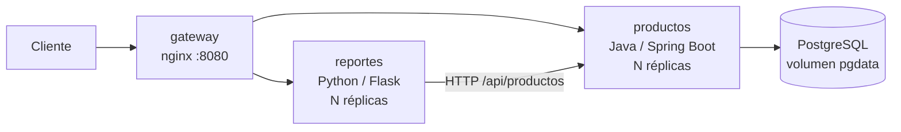
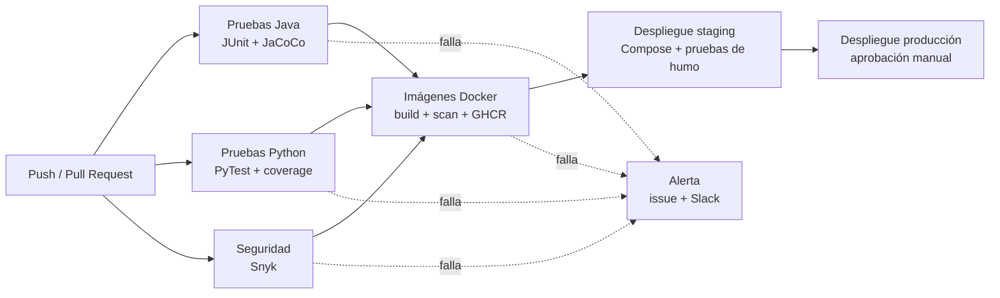

# EP2 · Pipeline CI/CD para microservicios (DOY0101 · Ingeniería DevOps)

<!-- Badge del pipeline: reemplace OWNER/REPO y quite los comentarios
[](https://github.com/OWNER/REPO/actions/workflows/ci-cd.yml)
-->

Pipeline **CI/CD completo en GitHub Actions** que automatiza el ciclo de vida de **dos microservicios**
(Java y Python): pruebas automatizadas, análisis de seguridad, construcción de imágenes Docker,
despliegue automático en un entorno simulado y orquestación con Docker Compose.

| Componente | Tecnología | Rol |
|---|---|---|
| `productos-java` | Java 21 · Spring Boot 4 · PostgreSQL | API REST de inventario (CRUD) |
| `reportes-python` | Python 3.12 · Flask · Gunicorn | Reportes de inventario; consume la API de productos |
| `gateway` | nginx (unprivileged) | Único punto de entrada y balanceador entre réplicas |
| `db` | PostgreSQL 17 | Base de datos (red interna, volumen persistente) |

## Arquitectura



Detalle de redes, healthchecks, escalado y arranque ordenado en [`docs/ARQUITECTURA.md`](docs/ARQUITECTURA.md).

## Pipeline CI/CD



| Etapa | Qué hace | Bloquea si… |
|---|---|---|
| **Pruebas Java** | `mvn verify`: JUnit Jupiter + Mockito, informe y regla de cobertura de **JaCoCo** | una prueba falla o la cobertura de líneas es < 80 % |
| **Pruebas Python** | `pytest` + `pytest-cov`, informes XML/HTML | una prueba falla o la cobertura es < 80 % |
| **Seguridad (Snyk)** | Dependencias (Maven y pip) y análisis estático de código (Snyk Code) | hay vulnerabilidades ≥ umbral (`high` por defecto) |
| **Imagen Docker** | Build multi-etapa, política *no-root*, escaneo **Snyk Container**, publicación en **GHCR** con SBOM y provenance | la imagen corre como root o Snyk encuentra vulnerabilidades ≥ umbral |
| **Despliegue staging** | `docker compose pull/up --wait` en un entorno simulado + pruebas de humo + evidencia | un healthcheck o una prueba de humo falla |
| **Despliegue producción** | Igual que staging, con más réplicas; admite aprobación manual | falla staging o no se aprueba |
| **Alerta** | Crea un *issue* `pipeline-alert` (y avisa a Slack si hay webhook) | — |

**Dependabot** (`.github/dependabot.yml`) revisa cada semana Maven, pip, los `Dockerfile`, `docker-compose.yml`
y las acciones de GitHub, y genera alertas y PR de actualización. Más detalle en [`docs/PIPELINE.md`](docs/PIPELINE.md).

## Estructura del repositorio

```
.
├── .github/
│   ├── workflows/ci-cd.yml        # pipeline principal
│   ├── workflows/deploy.yml       # despliegue reutilizable (staging / producción)
│   ├── dependabot.yml             # escaneo y actualización de dependencias
│   └── pull_request_template.md · ISSUE_TEMPLATE/
├── services/
│   ├── productos-java/            # Spring Boot + Dockerfile + pruebas JUnit
│   └── reportes-python/           # Flask + Dockerfile + pruebas PyTest
├── gateway/default.conf           # nginx: rutas, balanceo, cabeceras de seguridad
├── deploy/
│   ├── env/{staging,production}.env   # réplicas y recursos por entorno
│   └── scripts/smoke-test.sh      # pruebas de humo posteriores al despliegue
├── scripts/ci/snyk-gate.sh        # traduce el resultado de Snyk en bloqueo + mensaje claro
├── docker-compose.yml             # orquestación
├── .env.example                   # plantilla de variables locales
└── docs/                          # documentación (ver índice abajo)
```

## Ejecución local

Requisitos: Docker con Compose v2. (Para las pruebas sin Docker: JDK 21 + Maven y Python 3.12.)

```bash
cp .env.example .env                 # edite DB_PASSWORD
docker compose up -d --build --wait  # construye y levanta todo; espera a los healthchecks

curl http://localhost:8080/health
curl -X POST http://localhost:8080/api/productos -H "Content-Type: application/json" \
     -d '{"sku":"TEC-001","nombre":"Teclado","precio":19990.5,"stock":3}'
curl http://localhost:8080/api/productos
curl http://localhost:8080/api/reportes/resumen
curl http://localhost:8080/info/productos        # versión y commit desplegados

docker compose up -d --scale productos=3        # escalar réplicas sin reconstruir
bash deploy/scripts/smoke-test.sh http://localhost:8080   # pruebas de humo
docker compose down -v                           # detener y borrar datos
```

Pruebas por separado:

```bash
cd services/productos-java  && mvn verify                 # JUnit + JaCoCo (informe en target/site/jacoco)
cd services/reportes-python && python -m venv .venv && . .venv/bin/activate \
    && pip install -r requirements-dev.txt && pytest      # PyTest + cobertura (informe en htmlcov/)
```

## Calidad y trazabilidad (resumen)

- **Calidad:** las pruebas y la cobertura mínima (80 %) son *puertas* del pipeline; los informes quedan como artefactos de cada ejecución.
- **Trazabilidad:** cada imagen se etiqueta con el **SHA del commit** y lleva etiquetas OCI, SBOM y provenance;
  el despliegue usa ese SHA, y cada microservicio expone su **commit, versión y hora de construcción** en
  `/info/productos` y `/info/reportes`. Cada despliegue deja un **manifiesto** (`evidencia-despliegue-*`) y
  queda registrado en *Environments*.

Detalle y cadena completa en [`docs/CALIDAD_Y_TRAZABILIDAD.md`](docs/CALIDAD_Y_TRAZABILIDAD.md).

## Seguridad y escalabilidad (resumen)

- Imágenes **multi-etapa**, usuario **no root** (UID 10001), JRE/slim mínimos, `HEALTHCHECK`.
- En ejecución: sistema de archivos **de solo lectura**, `cap_drop: ALL`, `no-new-privileges`, red de datos **interna**,
  límites de CPU/memoria/procesos, gateway con **limitación de tasa** y cabeceras de seguridad; `/actuator` **no** se publica.
- **Escalabilidad parametrizada por entorno:** réplicas y recursos en `deploy/env/*.env` (staging 2+2, producción 3+2).
- Permisos mínimos del `GITHUB_TOKEN`, secretos solo por *secrets*, contraseña de BD aleatoria y enmascarada en cada despliegue.

Detalle en [`docs/SEGURIDAD.md`](docs/SEGURIDAD.md).

## Configuración inicial en GitHub (una sola vez)

1. Subir este repositorio a GitHub (rama `main`; cree también `develop`).
2. Crear el secret **`SNYK_TOKEN`** (cuenta gratuita en snyk.io) y **activar Snyk Code** en la organización de Snyk.
3. Activar *Dependency graph*, *Dependabot alerts* y *Dependabot security updates*.
4. Crear los *Environments* `staging` y `production` (en producción, agregar revisores requeridos).
5. Proteger `main` y `develop` exigiendo los checks del pipeline.

Paso a paso (con los nombres exactos de los checks) en [`docs/CONFIGURACION_GITHUB.md`](docs/CONFIGURACION_GITHUB.md).

## Cumplimiento de la pauta de evaluación

| Indicador | Evidencia en el repositorio |
|---|---|
| **IE1** Contenedores | Dos `Dockerfile` distintos y multi-etapa: [`productos-java`](services/productos-java/Dockerfile) (JRE Alpine) y [`reportes-python`](services/reportes-python/Dockerfile) (Python slim); build en el job `docker` |
| **IE2** Pruebas automatizadas | JUnit/Mockito + JaCoCo ([`services/productos-java/src/test`](services/productos-java/src/test)) y PyTest + cobertura ([`services/reportes-python/tests`](services/reportes-python/tests)); jobs `test-java` y `test-python` con umbral de cobertura |
| **IE3** Escalabilidad y seguridad en el pipeline | Snyk (dependencias, código, imagen) con bloqueo por `snyk-gate.sh`; Dependabot; política no-root; réplicas/recursos por entorno; alerta automática (job `alerta`) |
| **IE4** Despliegue automático y trazabilidad | [`deploy.yml`](.github/workflows/deploy.yml): pull desde GHCR por SHA, `compose up --wait`, pruebas de humo, manifiesto y *Environments*; [`docs/CALIDAD_Y_TRAZABILIDAD.md`](docs/CALIDAD_Y_TRAZABILIDAD.md) |
| **IE5** Orquestación | [`docker-compose.yml`](docker-compose.yml): 4 servicios, redes segmentadas, volumen, `depends_on` con *healthchecks*, réplicas, límites de recursos, *restart policy* |

## Documentación

| Documento | Contenido |
|---|---|
| [`docs/ARQUITECTURA.md`](docs/ARQUITECTURA.md) | Componentes, redes, orquestación con Compose, escalado |
| [`docs/PIPELINE.md`](docs/PIPELINE.md) | Cada etapa del pipeline, parámetros y artefactos |
| [`docs/CALIDAD_Y_TRAZABILIDAD.md`](docs/CALIDAD_Y_TRAZABILIDAD.md) | Políticas de calidad y cadena de trazabilidad commit → producción |
| [`docs/SEGURIDAD.md`](docs/SEGURIDAD.md) | Capas de seguridad y mecanismos de bloqueo/alerta |
| [`docs/CONFIGURACION_GITHUB.md`](docs/CONFIGURACION_GITHUB.md) | Secrets, Dependabot, Environments y protección de ramas |
| [`docs/USO_DE_IA.md`](docs/USO_DE_IA.md) | Declaración y citación del uso de IA |
| [`docs/CONCLUSIONES.md`](docs/CONCLUSIONES.md) | Justificaciones técnicas, conclusiones y reflexiones individuales |
| [`CONTRIBUTING.md`](CONTRIBUTING.md) · [`CHANGELOG.md`](CHANGELOG.md) · [`SECURITY.md`](SECURITY.md) | Flujo de trabajo, historial de cambios y política de seguridad |

## Equipo

| Integrante | Rol / contribución |
|---|---|
| _Nombre y apellido_ | _completar_ |
| _Nombre y apellido_ | _completar_ |

## Limitaciones conocidas

- El **entorno de despliegue es simulado**: el runner de GitHub hace de servidor y se destruye al terminar el job
  (no hay un servidor persistente). Los despliegues, sus pruebas y su evidencia sí son reales.
- El esquema de la base de datos lo gestiona Hibernate (`ddl-auto=update`); un sistema real usaría migraciones (Flyway/Liquibase).
- Las pruebas de humo del gateway verifican balanceo entre réplicas por DNS round-robin, no *rolling updates*.
