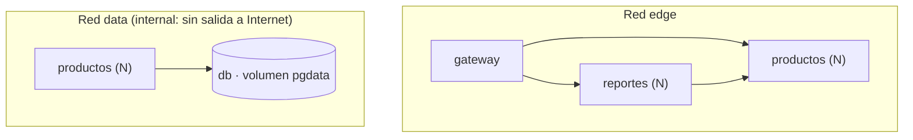

# Arquitectura y orquestación con Docker Compose

## Componentes

| Servicio | Imagen | Puerto interno | Publicado | Redes |
|---|---|---|---|---|
| `gateway` | `nginxinc/nginx-unprivileged:1.30-alpine` | 8080 | **sí** (`GATEWAY_PORT`, 8080 por defecto) | `edge` |
| `productos` | imagen propia (Java 21 + Spring Boot 4) | 8081 | no | `edge`, `data` |
| `reportes` | imagen propia (Python 3.12 + Flask + Gunicorn) | 8000 | no | `edge` |
| `db` | `postgres:17-alpine` | 5432 | no | `data` |



(`productos` pertenece a ambas redes: es el único servicio que puede hablar con la base de datos.)

## Estrategia de orquestación (IE5)

| Mecanismo | Cómo se aplica en `docker-compose.yml` |
|---|---|
| **Orden de arranque** | `depends_on` con `condition: service_healthy`: `db` → `productos` → `reportes` → `gateway`. Nada recibe tráfico hasta que su dependencia está sana. |
| **Salud** | Cada servicio define `healthcheck` (`pg_isready`, `/actuator/health`, `/health`). `docker compose up --wait` falla si alguno no queda sano. |
| **Recuperación** | `restart: unless-stopped` en todos los servicios; la JVM usa `-XX:+ExitOnOutOfMemoryError` para que un OOM reinicie el contenedor en vez de dejarlo degradado. |
| **Escalabilidad horizontal** | `deploy.replicas` (`PRODUCTOS_REPLICAS`, `REPORTES_REPLICAS`) o `docker compose up -d --scale productos=3`. Los servicios escalables no publican puertos ni usan `container_name`. |
| **Balanceo** | El gateway resuelve `productos` y `reportes` por el DNS interno de Docker, que devuelve **todas** las réplicas; nginx las usa en *round-robin* y vuelve a resolver cada 5 s (detecta réplicas nuevas sin reiniciar). |
| **Recursos** | `deploy.resources.limits/reservations` (CPU y memoria) y `pids_limit` por contenedor; los valores por entorno están en `deploy/env/*.env`. |
| **Aislamiento** | Dos redes: `edge` y `data` (`internal: true`). La base de datos no es alcanzable desde el gateway ni desde Internet. |
| **Persistencia** | Volumen con nombre `pgdata` para PostgreSQL (el despliegue simulado lo elimina al terminar con `down --volumes`). |
| **Configuración** | Variables de entorno (`.env`); la contraseña de BD es obligatoria (`${DB_PASSWORD:?...}`) y nunca está en el repositorio. |
| **Endurecimiento** | `read_only`, `tmpfs: /tmp`, `cap_drop: ALL`, `no-new-privileges` (bloque `x-seguridad-app`, reutilizado por 3 servicios). |

## Parámetros por entorno

| Parámetro | Local (`.env.example`) | Staging | Producción |
|---|---|---|---|
| Réplicas `productos` | 2 | 2 | 3 |
| Réplicas `reportes` | 2 | 2 | 2 |
| CPU / memoria por réplica de `productos` | 1.00 / 768 MB | 1.00 / 768 MB | 1.00 / 1024 MB |
| CPU / memoria por réplica de `reportes` | 0.50 / 256 MB | 0.50 / 256 MB | 0.50 / 256 MB |

## API publicada por el gateway

| Ruta | Destino | Descripción |
|---|---|---|
| `GET /health` | gateway | Salud del gateway |
| `GET /info/productos` | `productos` → `/actuator/info` | Versión, commit, hora de construcción e instancia |
| `GET /info/reportes` | `reportes` → `/info` | Ídem |
| `GET·POST /api/productos` · `GET·PUT·DELETE /api/productos/{id}` | `productos` | CRUD de productos (validación con Bean Validation; errores RFC 9457) |
| `GET /api/reportes/resumen` | `reportes` | Totales, valor del inventario, producto más caro, sin stock / bajo stock |
| `GET /api/reportes/bajo-stock?umbral=N` | `reportes` | Productos con stock ≤ N (400 si `umbral` es inválido; 503 si `productos` no responde) |

Cualquier otra ruta (por ejemplo `/actuator/*`) responde **404**: los endpoints operativos no se exponen.

## Operación

```bash
docker compose ps                         # estado y salud de cada réplica
docker compose logs -f gateway            # log del gateway (incluye rid=<id de petición> y upstream=<réplica>)
docker compose up -d --scale productos=4  # escalar en caliente
docker compose down -v                    # detener y borrar el volumen de datos
```
