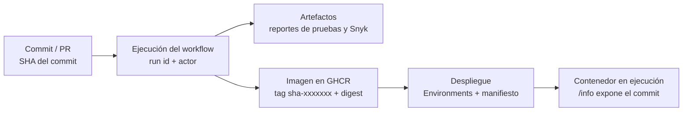

# Calidad y trazabilidad

## 1. Cómo se garantiza la calidad

### Políticas de calidad del proyecto

| # | Política | Umbral | Cómo se verifica | Si no se cumple |
|---|---|---|---|---|
| Q1 | Todas las pruebas automatizadas pasan | 100 % | Surefire (Java) y PyTest (Python) en cada PR/push | El job falla y no se construyen imágenes |
| Q2 | Cobertura de líneas del microservicio Java | ≥ 80 % | JaCoCo `check` (regla `LINE COVEREDRATIO`) | `mvn verify` falla |
| Q3 | Cobertura de líneas del microservicio Python | ≥ 80 % | `pytest --cov-fail-under` | `pytest` termina con error |
| Q4 | Sin vulnerabilidades de severidad ≥ umbral | `high` | Snyk (dependencias, código, imagen) | Se bloquea el pipeline y se crea una alerta |
| Q5 | Las imágenes no corren como root | UID ≠ 0 | `id -u` dentro de la imagen | El job `docker` falla |
| Q6 | El despliegue arranca sano | Todos los healthchecks en verde | `docker compose up --wait` | El despliegue falla |
| Q7 | El despliegue funciona de extremo a extremo | 100 % de las pruebas de humo | `deploy/scripts/smoke-test.sh` | El despliegue falla |
| Q8 | Lo desplegado es lo validado | Commit en `/info` = commit del pipeline | Pruebas de humo (paso 2) | El despliegue falla |

Los umbrales Q2–Q4 se ajustan sin tocar el código con las variables `COVERAGE_MIN` y `SNYK_SEVERITY_THRESHOLD` (ver [`PIPELINE.md`](PIPELINE.md)).

### Qué cubren las pruebas (casos críticos)

| Servicio | Tipo | Casos |
|---|---|---|
| `productos-java` | Unitarias (Mockito) | Alta con SKU nuevo y duplicado, actualización (mismo SKU / SKU de otro producto), baja, consulta inexistente |
| `productos-java` | Integración (Spring + H2 + MockMvc) | CRUD completo por HTTP, `201` + `Location`, validaciones `400` (nombre vacío, precio ≤ 0, stock negativo, precio ausente), `404`, `409`, `/actuator/health` y `/actuator/info` |
| `reportes-python` | Unitarias | Cálculo del resumen (vacío, totales, valor sin errores de coma flotante, más caro, sin/bajo stock, campos faltantes), filtro por umbral |
| `reportes-python` | Cliente HTTP (sesión simulada) | Respuesta correcta, error HTTP, sin conexión, JSON inválido, respuesta inesperada |
| `reportes-python` | API (Flask test client) | `/health`, `/info`, `/resumen`, `/bajo-stock` (por defecto, personalizado, inválido), `503` si `productos` cae, `404` JSON |

Los informes de cada ejecución quedan como artefactos (`reportes-java`, `reportes-python`) y su cobertura se resume en la pestaña *Summary*.

## 2. Cómo se garantiza la trazabilidad

La trazabilidad permite responder, para cualquier contenedor en ejecución: *¿qué commit es, quién lo disparó, qué pruebas pasó y qué imagen exacta es?*



| Eslabón | Mecanismo | Dónde se ve |
|---|---|---|
| Código → ejecución | Cada ejecución del workflow queda ligada al SHA, la rama/tag y el actor | Pestaña *Actions* |
| Calidad de ese SHA | Informes de pruebas/cobertura y de Snyk como artefactos | *Actions › ejecución › Artifacts* |
| Ejecución → imagen | Tags `sha-<7>`, rama, `latest`, `X.Y.Z`/`X.Y` (en *tags* semver) | GHCR (*Packages*) |
| Metadatos de la imagen | Etiquetas OCI (`org.opencontainers.image.revision`, `.source`, `.created`, `.title`…) generadas por `docker/metadata-action` | `docker image inspect` |
| Composición de la imagen | **SBOM** y **provenance** (`mode=max`) adjuntos a la imagen | `docker buildx imagetools inspect` |
| Imagen → contenedor | `build-args` `GIT_COMMIT`, `APP_VERSION`, `BUILD_TIME` quedan como variables de entorno de la imagen | `/info/productos` y `/info/reportes` |
| Despliegue | El job usa `environment:` (historial de despliegues) y se despliega **por SHA**, con `--no-build` | *Environments* / *Deployments* |
| Evidencia | `manifiesto-<entorno>.json` con commit, ejecución, actor, fecha y *digest* de cada imagen | Artefacto `evidencia-despliegue-<entorno>` |
| Incidentes | Issues `pipeline-alert` con el commit y el enlace a la ejecución | *Issues* |
| Versionado | *Tags* `vX.Y.Z` ↔ [`CHANGELOG.md`](../CHANGELOG.md) ↔ imágenes `X.Y.Z` | *Releases / tags* |

### Cómo verificarlo

```bash
# ¿Qué commit está corriendo?
curl http://localhost:8080/info/productos
curl http://localhost:8080/info/reportes

# Etiquetas OCI de una imagen publicada
docker image inspect ghcr.io/<owner>/<repo>/productos:sha-<7 caracteres> --format '{{json .Config.Labels}}'

# SBOM y provenance asociados
docker buildx imagetools inspect ghcr.io/<owner>/<repo>/productos:sha-<7 caracteres>

# Ejecución del pipeline que produjo ese commit (GitHub CLI)
gh run list --commit <sha>
```

### Flujo de trabajo (ramas → entornos)

| Rama / evento | Entorno resultante |
|---|---|
| `feature/*` → PR a `develop` | Solo validación (pruebas, seguridad, imagen sin publicar) |
| `develop` | Staging |
| PR `develop` → `main` y *merge* | Staging → Producción (con aprobación) |
| *Tag* `vX.Y.Z` | Imágenes versionadas + staging → producción |

Los mensajes de commit siguen *Conventional Commits* y cada PR usa la plantilla de `.github/pull_request_template.md` (ver [`CONTRIBUTING.md`](../CONTRIBUTING.md)).
