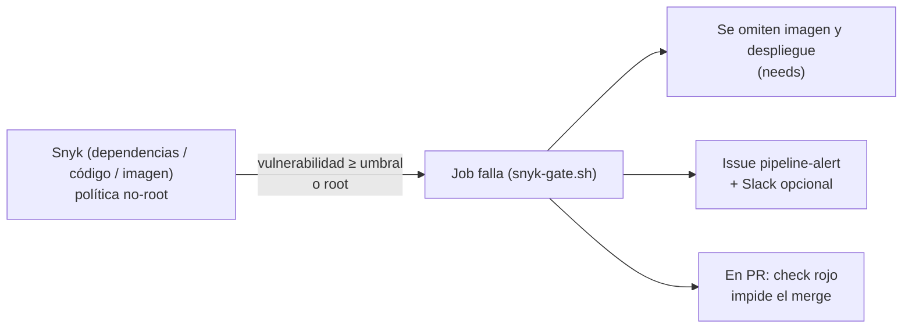

# Seguridad y gobernanza

La seguridad se aplica por capas: **código y dependencias → imagen → ejecución → pipeline**. Las capas de código e imagen
**bloquean** el pipeline; las demás son configuración permanente.

## Capa 1 · Código y dependencias

| Control | Herramienta | Efecto |
|---|---|---|
| Vulnerabilidades en dependencias Java/Python | **Snyk Open Source** (`snyk test`) | Bloquea si hay severidad ≥ `SNYK_SEVERITY_THRESHOLD` |
| Defectos de seguridad en el código | **Snyk Code** (`snyk code test`) | Bloquea con el mismo umbral |
| Alertas y actualizaciones automáticas | **Dependabot** (alerts, security updates y version updates) | PR semanales para Maven, pip, Dockerfiles, Compose y acciones |
| Credenciales fuera del código | Variables de entorno, *secrets* de GitHub, `.env` ignorado por Git | `DB_PASSWORD` es obligatoria y no tiene valor por defecto |

## Capa 2 · Imagen Docker

| Control | Dónde |
|---|---|
| Multi-etapa: la imagen final no contiene JDK, Maven, pip ni código de pruebas | `Dockerfile` de cada servicio |
| Bases mínimas (`eclipse-temurin:21-jre-alpine`, `python:3.12-slim`) | `Dockerfile` |
| Usuario **no root** con UID/GID fijos (10001) | `Dockerfile`; el pipeline **verifica** `id -u ≠ 0` |
| `HEALTHCHECK` en la imagen | `Dockerfile` |
| Escaneo de la imagen (**Snyk Container**) antes de publicarla | job `docker` |
| SBOM y provenance adjuntos | `build-push-action` (`sbom: true`, `provenance: mode=max`) |
| `.dockerignore` (nada de pruebas, `.git` ni informes dentro de la imagen) | cada servicio |

## Capa 3 · Ejecución (Docker Compose y gateway)

| Control | Valor |
|---|---|
| Sistema de archivos raíz | `read_only: true` + `tmpfs: /tmp` |
| Capacidades de Linux | `cap_drop: [ALL]` |
| Escalada de privilegios | `no-new-privileges: true` |
| Red de datos | `internal: true` (sin salida a Internet); solo `productos` accede a la BD |
| Superficie expuesta | Solo el puerto del gateway; `/actuator/*` responde 404 |
| Recursos | Límites de CPU, memoria y procesos por contenedor |
| Gateway | nginx *unprivileged*, `server_tokens off`, límite de **50 peticiones/s por IP** (429), cuerpo máx. 1 MB, `X-Content-Type-Options`, `X-Frame-Options`, `Referrer-Policy`, `Cache-Control: no-store`, `X-Request-ID` para correlación |
| Apagado ordenado | `server.shutdown=graceful` (Java) y `exec` como PID 1 |

## Capa 4 · Pipeline y gobernanza

| Control | Detalle |
|---|---|
| **Mínimo privilegio** | `permissions: contents: read` por defecto; escalados puntuales por job (`packages`, `issues`) |
| **Secretos** | `SNYK_TOKEN` y `SLACK_WEBHOOK_URL` solo como *secrets*; la contraseña de BD de cada despliegue se genera aleatoriamente y se enmascara en los logs |
| **Separación de entornos** | `staging` y `production` como *Environments*; producción admite aprobación manual y restricción de ramas |
| **Protección de ramas** | `main`/`develop` exigen PR y los checks del pipeline (ver [`CONFIGURACION_GITHUB.md`](CONFIGURACION_GITHUB.md)) |
| **Inmutabilidad** | Se despliega por **SHA** y con `--no-build`: lo desplegado es la imagen ya validada |
| **Cadena de suministro** | Acciones fijadas por versión mayor y actualizadas por Dependabot; SBOM/provenance de las imágenes |

## Bloqueos y alertas (IE3)

- **Bloqueo:** el resultado de cada análisis se evalúa con `scripts/ci/snyk-gate.sh`; un código de salida distinto de 0 detiene el pipeline.
  Como `docker`, `deploy-staging` y `deploy-production` dependen (`needs`) de las etapas anteriores, **no se publica ni se despliega nada** si algo falla.
- **Alerta:** el job `alerta` abre un issue con el detalle y, opcionalmente, notifica por Slack; además GitHub envía correo por ejecución fallida.
- **Excepciones:** si una vulnerabilidad no tiene parche, evaluarla y documentar la excepción (archivo `.snyk` con fecha de expiración) en vez de bajar el umbral globalmente.

## Cómo reportar un problema de seguridad

Ver [`SECURITY.md`](../SECURITY.md).
